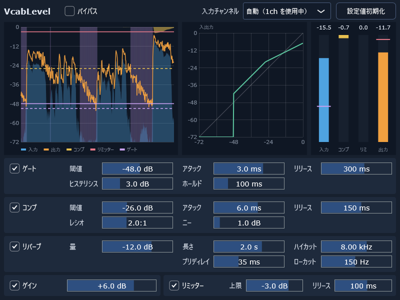

# VcabLevel



声のための、ゲート・コンプ・ゲイン・リミッターと、リバーブを 1 つにまとめたプラグインです。遅延は 1ms です（リミッターの先読み）。

デノイズ、ボイスチェンジャー（[VcabShift](https://github.com/xelloss120/VcabShift) など）、EQ（[VcabTone](https://github.com/xelloss120/VcabTone) など）の後ろ、チェーンの最後に置く想定です。

| 項目 | 内容 |
|---|---|
| 形式 | VST3 プラグインと、単体で動く EXE 版 |
| 対応 | Windows（64bit） |
| 遅延 | 1ms（リミッターをオフにしても変わりません） |
| 負荷 | CPU 1 コアの約 0.1%、リバーブをオンにすると約 0.2%（48kHz。音の処理だけ） |

## 処理の並び

```
入力 ─┬─────────────────── ゲートの判定
      └→ コンプ → ゲイン → ゲートの開け閉め ─┬─────────────┬→ リミッター → 出力
                                             └→ リバーブ ──┘（足す）
```

- **ゲートは、判定を入口、開け閉めをコンプとゲインの後に**しています。判定は音量を変える前の音で行うので、ゲインや上限を動かしても閾値を直す必要がありません。消すのはコンプの後なので、話し終わりのフェードが設定どおりにかかり、コンプの戻りで語尾の後の雑音が持ち上がることもありません。
- **リバーブはゲートの後ろ**です。ゲートが閉じても響きの尾は自然に消えていき、黙っている間の雑音には響きが付きません。元の声はそのまま通し、同じ声から作った響きを足します。
- **ゲインはコンプとリミッターの間**です。リミッターにどれだけ押し込むかを決めます（コンプの Makeup の代わり）。
- **リミッターは最後**なので、響きを足しても上限を超えません。
- 5 つの段は、それぞれオン/オフできます（リバーブは初期値がオフ）。

## できること

| 段 | つまみ（初期値） |
|---|---|
| ゲート | 閾値（-42dB）、ヒステリシス（3dB）、アタック（3ms）、ホールド（100ms）、リリース（300ms）。閉じると無音 |
| コンプ | 閾値（-18dB）、レシオ（2:1）、ニー（1dB）、アタック（10ms）、リリース（100ms）。大きさは直近 10ms の平均（RMS）で見ます |
| ゲイン | -12〜+12dB（+6dB） |
| リバーブ | 量（-18dB）、長さ（1.5 秒）、プリディレイ（35ms）、ハイカット（6kHz）、ローカット（200Hz）。初期値は歌うとき向けです。会話に薄く付けるなら、量 -24dB、長さ 0.5 秒、プリディレイ 10ms くらいが目安です |
| リミッター | 上限（-3dB）、リリース（100ms）。1ms 先読みして、山の手前からなめらかに下げます。点と点の間にできる山（ISP）も見ます |
| 画面 | 直近 5 秒の流れ（入力と出力の大きさ、コンプとリミッターの削り量、ゲートが閉じていた所）、入出力の特性（ゲート・コンプ・ゲイン・リミッターを通した折れ線。リバーブは入れない）、メーター（入力・コンプ・リミッター・出力） |

- ゲートの**ヒステリシス**は、閉じる線を開く線より下げる量です。語尾で音が線のまわりを上下しても、開け閉めを繰り返しません。**ホールド**は、閉じる線を下回ってから閉じ始めるまで待つ時間で、単語の間の短い切れ目で閉じないようにします。
- リミッターの上限は、点と点の間の山を 4 倍に補間して見ています。20kHz より上の成分が多い音（白色雑音など）では、上限を少し（0.1dB ほど）越えることがあります。声は、前段のハイカットで 16kHz より上がほとんどないので、越えません。

## 使うときの注意

**ヘッドフォンで使ってください。** スピーカーで鳴らすと、出た音をマイクが拾って、ハウリング（キーンという大きな音）が起きることがあります。EXE 版は、起動してすぐ音が出るように、入力の消音を初めからオフにしています。

EXE 版の初回は、「オーディオ設定」ボタン（左上の「オプション」の中と同じ画面）から、入力と出力のデバイスを選んでください。マイクの入力チャンネル（1ch / 2ch）は、初期値の「自動」で、音が来ているほうを選びます。

ゲートの閾値は、黙っているときの雑音より上、小さな声より下に置いてください。画面の「時間の流れ」で、紫の実線（開く線）と入力（青）を見比べると合わせやすくなります。

## EXE 版を初めて起動するとき

署名をしていないので、ダウンロードした EXE を初めて実行すると、Windows の「PC が保護されました」という青い画面が出ます。次のどちらかで実行できます。

- 「詳細情報」を押してから「実行」を押す
- 実行する前に、EXE（または ZIP）を右クリック → プロパティ → 下のほうの「許可する」にチェック → OK

## ビルド

必要なもの: Visual Studio 2022（C++ によるデスクトップ開発）、CMake 3.22 以上、Git

```
git clone https://github.com/xelloss120/VcabLevel.git
cd VcabLevel
git submodule update --init
cmake -S . -B build -G "Visual Studio 17 2022" -A x64
cmake --build build --config Release
```

- `C:\src` のような浅い場所に置いてください。深い場所だと、Windows のパスの長さの制限で、clone やサブモジュールの取得が失敗することがあります。
- サブモジュールは JUCE だけです。

できるもの:

| ファイル | 内容 |
|---|---|
| `build/VcabLevel_artefacts/Release/VST3/VcabLevel.vst3` | VST3 プラグイン（フォルダ。フォルダごとコピーして使う） |
| `build/VcabLevel_artefacts/Release/Standalone/VcabLevel.exe` | EXE 版 |
| `build/vcablv_render_artefacts/Release/vcablv_render.exe` | 開発用の WAV 処理ツール |
| `build/vcablv_shot_artefacts/Release/vcablv_shot.exe` | 開発用の画面の撮影ツール（WAV を流しながら、プラグインの画面を PNG に書き出す。この README の画像もこれで作った） |

## 開発用のツール

`vcablv_render` は、WAV ファイルにプラグインと同じ処理をかけて書き出します。設定は `キー=値` で渡します（キーは `Source/Core/Params.cpp` の一覧）。

```
vcablv_render in.wav out.wav gate_threshold=-50 comp_ratio=3 gain=4
vcablv_render in.wav out.wav --trace trace.csv
```

- `--trace`: 10ms ごとの入力と出力の山、コンプが見ている大きさ（RMS）、コンプとリミッターの削り量、ゲートの倍率を CSV に書く
- `--set-at 秒 キー=値`: 途中から設定を変える
- 出力は遅延（1ms）を詰めずに書きます（プラグインと同じ）

`Tools/Check/check.py` は、決まった音（雑音、正弦波）を処理ツールに通して、遅延、素通し、リミッターの上限、コンプの効き方、ゲートの動きを数値で確かめます（Python 3、numpy、scipy、soundfile が要ります）。

`Tools/Icon/make_icon.py` は、アイコンを作ります。

## ライセンス

Copyright (C) 2026 x120

[AGPLv3](LICENSE)（AGPL-3.0-only）。使っているライブラリ（JUCE など）のライセンスは [THIRD_PARTY_LICENSES.md](THIRD_PARTY_LICENSES.md) にまとめています。ASIO SDK を GPLv3 で使っているため、GPLv3 の本文を [LICENSES/GPL-3.0.txt](LICENSES/GPL-3.0.txt) に置いています。

アイコンの図柄は VoiChanAlgoBox のアイコン（同じ作者）を使っています。文字は Noto Sans Bold（SIL Open Font License）です。

VST is a trademark of Steinberg Media Technologies GmbH, registered in Europe and other countries.
